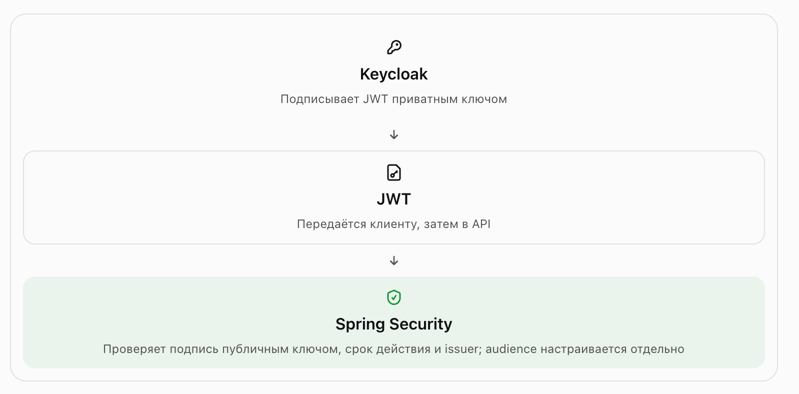

### Начало

Подняли keycloak (в докер командах строка). Изучим понятия:

- Realm - Отдельное пространство для пользователей, ролей, клиентов и настроек авторизации. Например, создадим company-realm для наших приложений.

- User - Пользователь, который будет входить в систему. Например, alice или bob.

- Client - Приложение или клиент, который взаимодействует с Keycloak. Например, admins-api или веб-приложение, через которое пользователь входит в систему.

Переходим по localhost:8080. Мы находимся в realm master.
Он предназначен прежде всего для администрирования самого Keycloak. 

#### Для наших экспериментов создадим отдельный realm.

- В левом верхнем углу найди список Current realm (или выпадающий список с названием master)
- Create realm.
- В поле Realm name введи company-realm.
- Нажми Create.

Разберёмся, что мы создали

- company-realm - Наше изолированное пространство для экспериментов. В нём будут собственные пользователи, клиенты и роли.
- master - Административный realm. Пока оставляем его для управления самим Keycloak.

#### Создаём пользователя.

- Убедись, что выбран realm company-realm.
1. В левом меню открой Users.
2. Нажми Create new user.
3. Заполни поля:
    - Username - alice
    - Email	- alice@example.com
    - First name - Alice
    - Last name	- Smith
    - Email verified - Пока выключено
4. Нажми Create

- Установи пароль
Открой созданного пользователя alice.
1. Перейди во вкладку Credentials.
2. Нажми Set password.
3. Укажи пароль, например Alice123!Test.
4. Отключи Temporary, чтобы пароль не требовалось менять при первом входе.
5. Подтверди действие.

- Разберём, что произошло
   Теперь в Keycloak есть пользователь alice, но это ещё не означает, что она может вызывать любые API.

Важно различать три вещи:
- User — кто пользователь.
- Authentication — удалось ли подтвердить его личность.
- Authorization — разрешено ли ему выполнить конкретное действие.
  Пока мы создали только учётную запись и настроили способ аутентификации.

- Создай второго пользователя
Повтори действия и создай пользователя bob с паролем Bob123!Test. Также отключи Temporary.
Позже мы назначим alice роль администратора, а bob оставим обычным пользователем. Так на практике увидим разницу между успешной аутентификацией и наличием прав.
Когда оба пользователя будут созданы, напиши «готово». Следующим шагом создадим client и получим первый токен через curl — это будет наш первый реальный запрос к Keycloak.

### Создаём Client
- Что такое Client
   Представь, что admins-api — это твой Spring Boot микросервис. Он должен понимать, каким пользователям можно выполнять запросы.

Для этого приложение регистрируется в Keycloak как Client.

Не путай два понятия:
- alice и bob — пользователи, которые хотят получить доступ.
- admins-api — приложение, которое использует механизмы Keycloak для аутентификации и авторизации.
  Client — это не обязательно браузер или отдельный пользователь. Это регистрация приложения в Keycloak.

Создаём admins-api. В Admin Console, находясь в company-realm:
1. Открой Clients.
2. Нажми Create client.
3. Выбери настройки:
   - Client type - OpenID Connect
   - Client ID - admins-api
   - Name - Admins API — необязательно

4. Нажми Next.
   На следующем экране могут быть настройки возможностей клиента. Пока используем их для простого учебного сценария.
5. Настрой Client для нашего первого эксперимента
   На экране Capability config выставь:
   - Client authentication	OFF
   - Authorization	OFF
   - Standard flow	ON
   - Direct access grants	ON
   - Service accounts roles	OFF

   Если интерфейс показывает дополнительные параметры, пока оставь их выключенными.

   Нажми Next, а затем Save (или сразу Save, если такого шага нет).

   Почему именно так:
      - Client authentication = OFF — для этого учебного клиента не понадобится client_secret.
        - Direct access grants = ON — позволит получить токен, передав логин и пароль пользователя через curl.
        - Standard flow = ON — оставим включённым для следующего эксперимента со входом через браузер.
          Важный нюанс: передача пароля пользователя непосредственно приложению через Direct Access Grants (password grant) нужна нам только для обучения. 
          Этот flow не рекомендуется для новых production-приложений; там разберём Authorization Code Flow с PKCE

6. Получаем первый токен

   curl -X POST \
   'http://localhost:8080/realms/company-realm/protocol/openid-connect/token' \
   -H 'Content-Type: application/x-www-form-urlencoded' \
   -d 'client_id=admins-api' \
   -d 'grant_type=password' \
   -d 'username=alice' \
   -d 'password=Alice123!Test'

   если ответ успешный, разберем что мы сделали:

   1. alice передала свои учётные данные.
   2. Keycloak проверил логин и пароль.
   3. Keycloak выдал access_token.
   4. Теперь этот токен можно передать Spring Boot API в заголовке Authorization: Bearer ....
      Пока мы ещё не защищали API — мы только получили удостоверение пользователя.

### что такое JWT, из чего он состоит и почему микросервис может ему доверять

Разбираем JWT
1. Что такое JWT?
   JWT (JSON Web Token) — компактный формат токена, который позволяет передавать набор утверждений (claims) о пользователе или клиенте.

   JWT обычно выглядит так:

         eyJhbGciOiJSUzI1NiIs.eyJzdWIiOiIxMjMifQ.signature

   Он состоит из трёх частей, разделённых точками:

   - Header - Алгоритм и тип
   - Payload - Данные и claims
   - Signature - Цифровая подпись

   Header сообщает, каким алгоритмом подписан токен. 
   Payload содержит claims. 
   Signature позволяет проверить, что подписанные части токена не были изменены.

   Важный момент: Payload обычно не зашифрован, а закодирован в Base64URL. Его может прочитать любой, у кого есть токен.

2. Посмотрим содержимое нашего токена

      Расшифруем например на https://www.jwt.io/

            {
            "exp": 1793271774,
            "iat": 1793271474,
            "jti": "onrtro:aab2b3b3-890e-c882-84ff-8fa4a03e5042",
            "iss": "http://localhost:8080/realms/company-realm",
            "aud": "account",
            "sub": "18fd7833-593f-487a-974f-d3023f736065",
            "typ": "Bearer",
            "azp": "admins-api",
            "sid": "5Md2QQ8P-EF2QyKb9KbvKaC3",
            "acr": "1",
            "realm_access": {
            "roles": [
            "offline_access",
            "uma_authorization",
            "default-roles-company-realm"
            ]
            },
            "resource_access": {
            "account": {
            "roles": [
            "manage-account",
            "manage-account-links",
            "view-profile"
            ]
            }
            },
            "scope": "email profile",
            "email_verified": false,
            "name": "Alice Smith",
            "preferred_username": "alice",
            "given_name": "Alice",
            "family_name": "Smith",
            "email": "alice@example.com"
            }
3. Разбираем основные claims

   - sub	- Уникальный идентификатор пользователя
   - preferred_username	- Логин, например alice
   - iss	- Кто выдал токен — наш Keycloak realm
   - exp	- Когда токен истекает
   - iat	- Когда токен был выпущен
   - azp	- Клиент, которому выдали токен
   - aud	- Для каких получателей предназначен токен
   - realm_access.roles	- Роли пользователя на уровне realm

   Особенно обрати внимание на sub. Это стабильный идентификатор пользователя в рамках его учётной записи. 
   Он лучше подходит для идентификации, чем username, который может измениться.

4. Почему Spring Boot доверяет этому JWT?
   Keycloak подписывает токен приватным ключом. 
   Spring Security получает соответствующий публичный ключ Keycloak и проверяет подпись.

   

   Таким образом, Spring Boot обычно не нужно спрашивать Keycloak о действительности каждого JWT. Он может проверить его самостоятельно.

   При этом корректная подпись ещё не означает, что пользователь имеет право выполнить конкретную операцию.

### Настраиваем роли

Задача: создадим роли ADMIN и USER, назначим их alice и bob, получим новые токены и увидим, 
как Keycloak отражает права пользователя в JWT

1. Что мы узнали из твоего JWT

         {
         "preferred_username": "alice",
         "iss": "http://localhost:8080/realms/company-realm",
         "azp": "admins-api"
         }

   А теперь самое интересное — роли:

         "roles": [
         "offline_access",
         "uma_authorization",
         "default-roles-company-realm"
         ]

   У Alice пока нет нашей бизнес-роли ADMIN. Есть только стандартные роли Keycloak. Мы сейчас это исправим.

2. Создаём две роли
   В Admin Console, в realm company-realm:
      1. Открой Realm roles в меню слева.
      2. Нажми Create role.
      3. Создай роль ADMIN.
      4. Аналогично создай роль USER.
         Это будут наши бизнес-роли:
         - ADMIN - Управлять пользователями и выполнять административные операции
         - USER	- Просматривать обычные данные

   Пока это только названия ролей. Сами по себе они ничего не запрещают и не разрешают — правила доступа мы позже настроим в Spring Security.

3. Назначаем роли пользователям
   Alice — администратор
   - Открой Users → alice.
   - Найди вкладку Role mapping.
   - Нажми Assign role.
   - Выбери ADMIN и подтверди назначение.
     
   Bob — обычный пользователь
     - Аналогично открой Users → bob и назначь ему только роль USER.

4. Получаем новый токен Alice. Декодируем, Видим роль ADMIN

          "realm_access": {
          "roles": [
          "offline_access",
          "uma_authorization",
          "ADMIN",
          "default-roles-company-realm"
          ]
          }
5. Что важно понять
   Мы пока не реализовали авторизацию в самом приложении. 
   Keycloak сообщает, какие роли назначены пользователю, а Spring Security будет решать, какие endpoint доступны этим ролям. Это принципиально важное разделение ответственности.
   Следующим шагом подключим Spring Boot и проверим всё настоящими HTTP-запросами.